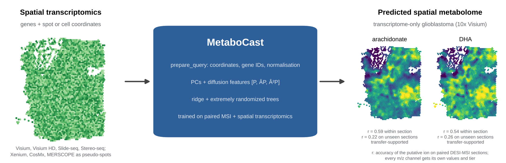

# MetaboCast

Predict spatial metabolite profiles from spatial transcriptomics.

[](https://github.com/himanshushekhar367-sudo/MetaboCast/actions/workflows/tests.yml)
[](LICENSE)

[](https://doi.org/10.5281/zenodo.23661778)

MetaboCast learns a map from gene expression and tissue position to metabolite intensities on paired spatial
transcriptomics and mass-spectrometry imaging (MSI), then predicts a spatial metabolome for sections profiled by
transcriptomics alone. Predictions come with each ion's accuracy on held-out tissue, an uncertainty width and a
putative annotation, so you can see which metabolite maps the transcriptome supports and which it does not.



- **Any spatial transcriptomics platform.** `metabocast.prepare_query()` reads coordinates and gene identifiers
  from Visium, Visium HD, Slide-seq, Stereo-seq, Xenium, CosMx and MERSCOPE data, normalises raw counts and
  aggregates single-cell or subcellular measurements into pseudo-spots.
- **Pre-trained model included.** `metabocast_model.pkl` predicts 2,086 DESI-MSI m/z channels for human tissue
  without any MSI from you.
- **Train your own.** Any paired cohort (DESI or MALDI, any species, any m/z panel) trains and benchmarks a new
  model with one command.
- **Reliability reporting.** Every ion carries its accuracy within sections and on unseen sections, an empirical
  uncertainty width and a reliability tier that separates ions supported on unseen tissue from ions supported only
  within sections, and gene-panel overlap is reported for every query.
- Python and R (Seurat) interfaces; runs on a CPU.

## Installation

```bash
git clone https://github.com/himanshushekhar367-sudo/MetaboCast.git
cd MetaboCast
pip install -e .                      # ".[reproduce]" adds the dependencies of the manuscript scripts
```

The clone includes the shipped model, the examples and the reproduction scripts. To install only the library,
use `pip install git+https://github.com/himanshushekhar367-sudo/MetaboCast.git@v1.0.0` and download
[`metabocast_model.pkl`](https://github.com/himanshushekhar367-sudo/MetaboCast/raw/v1.0.0/metabocast_model.pkl)
separately.

MetaboCast needs Python 3.9 or later with NumPy, SciPy, scikit-learn, pandas, AnnData and Scanpy; the test suite
passes on Python 3.9 and 3.11. The versions used to build the shipped model are pinned in `requirements-lock.txt`
(these pins need Python 3.11 or later).

## Quick start

From the command line:

```bash
python examples/predict_on_your_data.py --model metabocast_model.pkl --query your_section.h5ad --out results/ --plot
```

| Output | Contents |
|---|---|
| `results/query_with_predictions.h5ad` | the section with predictions in `.obsm["metabocast_pred"]` (columns follow `.uns["metabocast_mz"]`) |
| `results/predicted_metabolites.csv` | one row per m/z channel: predicted mean and spatial s.d., annotation, chemical class, accuracy within sections and on unseen sections, uncertainty width, reliability tier |
| `results/predicted_maps.png` | maps of the most spatially structured predictions (with `--plot`) |

In Python:

```python
import anndata as ad
from metabocast import MetaboCast, prepare_query, gene_panel_overlap

model = MetaboCast.load("metabocast_model.pkl")
query = prepare_query(ad.read_h5ad("your_section.h5ad"))   # coordinates, gene symbols, log1p(CP10k)
print(gene_panel_overlap(model, query))                      # share of the model's genes measured in the query
pred = model.predict_metabolome(query)                       # spots x 2,086 m/z channels, log1p intensity
table = model.reliability_table(query)                       # per-ion accuracy, annotation and reliability tier
```

## Input data

A query needs gene expression and two-dimensional coordinates for each spot, cell or bin, in an AnnData `.h5ad`
file. `prepare_query()` handles the platform-specific details and records what it did in
`.uns["metabocast_input"]`:

| Platform | Coordinates read from | Recommended call |
|---|---|---|
| 10x Visium, Visium HD (8 or 16 µm bins), Slide-seq, Stereo-seq bins | `obsm["spatial"]` | `prepare_query(adata)` |
| 10x Xenium | `obs["x_centroid"]`, `obs["y_centroid"]` (µm) | `prepare_query(adata, bin_size=50)` |
| Vizgen MERSCOPE / MERFISH | `obs["center_x"]`, `obs["center_y"]` (µm) | `prepare_query(adata, bin_size=50)` |
| NanoString CosMx | `obs["CenterX_global_px"]`, `obs["CenterY_global_px"]` (pixels) | `prepare_query(adata, bin_size=...)`, in pixels |
| Other layouts | any `obsm` key or pair of `obs` columns | `prepare_query(adata, spatial_key="x,y")` |

- **Gene identifiers.** Genes are matched by symbol. Ensembl identifiers are replaced by the symbol column of
  `.var` when one exists (`symbol_column=` chooses it).
- **Normalisation.** Raw counts are converted to log1p(CP10k); an existing `layers["log1p"]` is used as is.
- **Single-cell and subcellular data.** `bin_size` sums counts over square pseudo-spots (in coordinate units),
  so that profiles approach the depth of spot-level training data. Bins never cross sections (`section_key`).
- **Species.** The shipped model was trained on human tissue. Low gene-panel overlap, or a different symbol case
  (mouse `Gfap` against human `GFAP`), means the query lies outside the training domain: train on paired data from
  your species (below), or use `uppercase_genes=True` for approximate matching.

The command-line tool exposes the same options (`--bin-size`, `--symbol-column`, `--spatial-key`,
`--counts-layer`, `--section-key`, `--uppercase-genes`; see `--help`).

## Reading the output

- `.obsm["metabocast_pred"]`: predicted log1p intensity for every m/z channel. `.obsm["metabocast_pred_rank"]`
  holds the same predictions on the rank (Gaussian score) scale used in training.
- `.uns["metabocast_conf_width"]`: per-ion 90% uncertainty half-width (log1p units) from leave-one-section-out
  residuals; `.uns["metabocast_conf_width_adj"]` widens it when the query lacks some of the model's genes. These
  are empirical widths, not coverage guarantees: on DESIUM patients excluded from fitting, penalty selection and
  width estimation they covered 88% of spots on average (80-92% across sections; nominal 90%).
- `model.reliability_table(adata)`: per-ion accuracy within sections (`train_predictability_spearman`) and on
  unseen sections (`transfer_predictability_spearman`), uncertainty width, putative candidates, chemical class and
  reliability tier: *transfer-supported* (unseen-section r ≥ 0.20), *within-section only* (within-section r ≥ 0.30
  but weaker transfer), *low* or *uncalibrated*. `focus="lipid_redox"` restricts the table to lipid, nucleotide and
  redox ions.

Predictions are hypotheses about the metabolome, not measurements. Read a prediction as worth measuring when the
query resembles the training tissue, gene-panel overlap is high, the ion is transfer-supported and its predicted map
is spatially structured; within-section-only ions are leads at most. Each m/z channel is an ion channel; names are
putative exact-mass candidates that need MS/MS or FDR-controlled annotation for confirmation.
[`docs/USAGE.md`](docs/USAGE.md) gives a checklist.

## The shipped model

`metabocast_model.pkl` was trained on seven paired DESI-MSI/Visium sections of human breast and lung cancer
(DESIUM; 14,816 spots, 2,086 negative-mode m/z channels). Accuracy under the manuscript protocols, as the median
Spearman correlation between predicted and measured intensity:

| Setting | Median Spearman |
|---|---|
| DESIUM, within section (spatial-block cross-validation, 1,000 best-measured ions, mean of 7 sections) | 0.337 |
| DESIUM, unseen section (leave-one-section-out, mean of 7) | 0.045 (breast 0.062, lung 0.023) |
| DESIUM, unseen patient | 0.042 |
| SMA MALDI lipids (DHB), unseen section of the same mouse, model trained on SMA | 0.32 |
| SMA MALDI neurotransmitters (FMP), mouse, unseen section, model trained on SMA | 0.20 (substantia nigra 0.29, striatum 0.10) |
| SMA MALDI neurotransmitters (FMP), human striatum, unseen section of the same donor | 0.15 |

Within paired sections MetaboCast was more accurate on average than factorisation and pathway-feature baselines and
than a coordinate-only smoother (the last in five of seven sections); on unseen tumour sections transfer was weak for
every method, and adding H&E features to the transcriptome improved it in all six sections tested (H&E features
alone were better than the transcriptome in four of six). The SMA cohorts use the spot-to-pixel pairing published with the deposit; they differ from DESIUM in
chemistry, species, tissue and design, so their higher transfer is not a ranking of tissues or methods. The
[model card](MODEL_CARD.md) describes training, intended use and failure modes.

## Train on your own paired data

Each training section is an `.h5ad` file with gene expression, coordinates in `obsm["spatial"]`, MSI intensities
in `uns["msi"]` (spots x ions) and the m/z axis in `uns["mz_features"]`:

```python
from metabocast import MetaboCast
model = MetaboCast().fit(train_sections)        # list of AnnData sections sharing one m/z axis
model.save("my_model.pkl")
```

To train every cohort in a folder and report leave-one-section-out accuracy in one step:

```bash
python pipeline/train_and_evaluate.py /path/to/paired_sections --out results/training
```

Sections are grouped by m/z axis and gene-symbol case, so different MSI panels or species become separate models;
`summary.json` and `loso_per_section.csv` report held-out accuracy. `pipeline/sma_to_metabocast.py` converts the
public SMA MALDI-MSI/Visium deposit into this format.

| Option | Default | Effect |
|---|---|---|
| `estimator` | `"ensemble"` | ridge regression averaged with 100 extremely randomized trees; `"ridge"` keeps the linear half only |
| `alpha` | `"auto"` | ridge penalty chosen by leave-one-section-out cross-validation (spatial blocks for a single section), or a fixed value |
| `alpha_grid` | 10⁻¹ to 10⁷ | penalties searched when `alpha="auto"`; a warning reports a selection at the largest value |
| `target_transform` | `"rank"` | rank-normalise each ion within each training section; `None` fits standardised log1p intensities |
| `use_kegg` | `False` | add KEGG metabolic-pathway activity features (bundled human gene sets) |
| `extra_key` | `None` | append a per-spot modality from `obsm` (protein, H&E features, cell-type signatures) |
| `gene_scaling` | `None` | `"section"` z-scores genes within each section |
| `n_hvg`, `n_pcs`, `k` | 3000, 100, 6 | highly variable genes, principal components, spatial neighbours |

For uncertainty widths on a retrained model, keep independent calibration sections out of training and run
`model.calibrate(calibration_sections, unit="section")`.

## Metabolic pathway activity

MetaboCast also scores KEGG or Reactome pathway activity per spot (`PathwayScorer`, with optional spatial
smoothing) and a metabolite-grounded activity that requires enzymes and their products to agree
(`MetabolicActivity`); see `examples/pathway_scores.py`, `examples/metabolic_activity.py` and
[`docs/USAGE.md`](docs/USAGE.md).

## R and Seurat

```r
source("R/metabocast.R")
model <- mc_load_model("metabocast_model.pkl")
seu   <- mc_run_rds("your_section.RDS", model)   # adds a "metabocast" assay
```

The R functions call the same Python model through reticulate (version 1.36 or later for NumPy 2); the
Seurat object needs coordinates in its images or in `meta.data` (`imagecol`/`imagerow`, `x`/`y`).

## Reproducing the manuscript

`reproduce/` holds every analysis script behind the manuscript and `reproduce/results/` the result files they
produced. Figures and supplementary tables are rebuilt from those results without the raw data:

```bash
pip install -e ".[reproduce]"
python reproduce/figures/make_figures.py --out figures
python reproduce/tables/build_supplementary_tables.py --out MetaboCast_Additional_file_2.xlsx
```

[`docs/ANALYSIS_MANIFEST.md`](docs/ANALYSIS_MANIFEST.md) links every figure and table to the scripts, result files
and settings behind it, [`reproduce/README.md`](reproduce/README.md) gives the commands, and
[`data/README.md`](data/README.md) lists the public datasets.

## Tests

```bash
pip install pytest
python -m pytest -q
```

## Citation

Release 1.0.0 (tag `v1.0.0`) is archived on Zenodo. If you use MetaboCast, please cite the software
([`CITATION.cff`](CITATION.cff) holds the same details):

> Shekhar H, Deep A, Minocha S, Kumar S. MetaboCast: predicting spatial metabolite maps from spatial transcriptomics
> with per-ion reliability. Version 1.0.0. Zenodo; 2026. https://doi.org/10.5281/zenodo.23661778

The reference of the accompanying manuscript will be added here on publication.

## Getting help

Report bugs and ask questions through [GitHub Issues](https://github.com/himanshushekhar367-sudo/MetaboCast/issues).

## License

[MIT](LICENSE)
